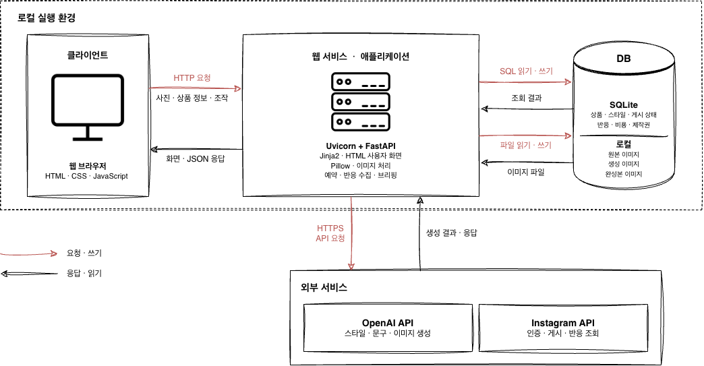

# 뽀스팅 · 카페 콘텐츠 제작

카페·베이커리 소상공인을 위한 콘텐츠 제작 서비스이다.<br> 
사진과 상품 정보를 기존 Instagram 분위기에 맞는 홍보물로 만들도록 돕는 웹앱이다.<br> 


[프로젝트 보고서](docs/project-report.pdf) · [개발일지](https://app.notion.com/p/3fec6fc0469681a8a6a8d8f8d4820a29)

## 결과 요약

모델은 한 번 생성하는 비용이 아니라 바로 쓸 수 있는 홍보물 1건을 얻는 비용으로 골랐다. gpt-image-2는 gpt-image-1-mini보다 1회 단가가 45.5% 비싸지만, 합격률이 5/5와 3/5로 달라 재시도까지 계산하면 합격 1건당 비용은 12.7% 낮았다. 문구와 스타일 분석은 같은 합격 기준에서 gpt-5.4-mini가 gpt-5.4보다 비용이 71% 적었다. 확정한 모델로 홍보물 1건을 만드는 데 약 $0.013이 든다.

이미지는 상품 영역의 DINO 유사도와 VGG Gram 스타일 거리로도 쟀다. 사람 체크리스트에서는 두 이미지 모델 모두 상품 보존 합격이었는데, DINO는 gpt-image-2 0.894, gpt-image-1-mini 0.753으로 차이가 났다. 결과 이미지는 입력 사진보다 기존 피드 스타일에 약 52% 가까웠다. 체크리스트 판정은 규칙과 LLM 판정기로 옮겼고, 사람 판정과 89~91% 일치했다.

다른 상품 5개를 실제 앱으로 만들었을 때 제작 시작부터 첫 AI 후보까지 중앙값 43.4초가 걸렸다. 이때 문구가 기존 피드와 말투가 달라서, 피드에서 센 말투 규칙을 넣어 마침표로 끝나는 줄을 63%에서 0%로 줄였다. 그래도 블라인드 비교에서는 고친 문구가 5개 중 2개만 선택됐다.

모두 한 가게, 평가자 1명 기준이다. 지표를 고른 이유와 한계는 [프로젝트 보고서](docs/project-report.pdf) 2-3절과 3-7절에 정리했다.

```bash
python -m backend.kpi_report        # 합격 1건당 비용·기대 대기 시간
python -m pip install -e ".[eval]"  # 평가용 의존성
python -m backend.eval_metrics      # 이미지 정량 지표
python -m backend.eval_judge        # 규칙·LLM 판정과 사람 일치도
```

## 서비스 시연 영상
[](https://youtu.be/T0XWwMQNAac)

- 00:00~00:55: 연결 상태·가게 스타일 설정과 저장
- 00:55~03:35: 상품 사진·정보 입력 / 문구·이미지 생성
- 03:35~05:15: 라인업 등록·확정 / 라인업 스토리 제작과 게시
- 05:15~05:55: 품절 처리 / 품절 스토리 제작·게시 조작
- 05:55~06:51: 브리핑 / 과거 게시물 반응 조회

## 기능

- 기존 Instagram 게시물이나 참고 사진으로 가게 스타일의 빈칸을 제안·저장
- 상품 사진과 확인된 정보로 문구·이미지를 만들고 원본 비교·수정·확정·다운로드
- 오늘 메뉴(라인업)·품절 공지 제작 및 당일 게시 예약 지원
- 과거 게시물 반응을 조회하고, 주기 브리핑에서 다음 게시물 초안 제안

### 아키텍처



| 구분 | 기술 | 역할 |
|-----|-----|-----|
| 서버 | Python 3.12 이상·FastAPI·Uvicorn | 요청 처리·기능 제공 |
| 화면 | Jinja2·HTML·CSS·JavaScript | 화면 렌더링·사용자 조작 |
| 저장 | SQLite·로컬 파일 | 상태·버전·비용·반응 및 이미지 보관 |
| 이미지 후처리 | Pillow | 미리보기·완성본 렌더링 |
| 외부 통신 | httpx | OpenAI·Instagram API 호출 |
| 인증·보호 | OAuth 상태·세션·CSRF·Fernet | 요청 검증·연결 토큰 암호화 |

## 로컬 실행

필수 조건: Python 3.12 이상.<br>
macOS/Linux에서 다음 명령을 순서대로 실행한다. 
[Windows 실행 방법](docs/configuration.md#windows)

```bash
git clone https://github.com/JINzinzara/content-marketing-ai.git
cd content-marketing-ai
python3 -m venv .venv
source .venv/bin/activate
python -m pip install -e .
python -m uvicorn backend.main:create_app --factory --port 8765 --workers 1
```

[http://127.0.0.1:8765](http://127.0.0.1:8765)에 접속한다. 백엔드와 프론트엔드가 함께 실행되며, 별도 프론트엔드 설치는 필요하지 않다.

[실행 상태 확인](http://127.0.0.1:8765/health)에서 `{"status":"ok"}`가 표시되면 정상이다.

## 환경 변수 설정

기본 실행에는 `.env`가 필요하지 않습니다. AI 생성과 실제 Instagram 연동은 비활성화되어 있으며, 화면 확인·수동 제작·확정·다운로드를 사용할 수 있습니다. DB와 파일은 `data/`에 자동 생성됩니다.

| 사용할 기능 | 필요한 설정 |
| --- | --- |
| AI 스타일·문구·이미지 생성 | [API 키·활성화·예산 설정](docs/configuration.md#ai-생성) |
| Instagram 연결·게시·반응 조회 | [Meta 앱·공개 HTTPS 설정](docs/configuration.md#instagram-연동) |

설정 후 서버를 다시 실행합니다. 자세한 사용법과 오류 해결은 [추가 설정·사용 안내](docs/configuration.md)를 참고합니다.

